 

 

 

**WEB DEVELOPMENT · UI/UX DESIGN · BRANDING · VISUAL DESIGN · MOTION DESIGN**

[LinkedIn](https://www.linkedin.com/in/fiona-marie-martizano-54670b3b1) · [Repositories](https://github.com/FioMartizano?tab=repositories)

---

## 01 / ABOUT

I'm Fio — a developer, UI/UX designer, and creative interested in the intersection of technology, user experience, branding, and visual expression.

I enjoy transforming ideas into functional digital products, designing intuitive interfaces, developing visual identities, and creating engaging digital experiences. My interests move between software development and the creative process: from structure and usability to typography, art direction, and motion.

- Fourth-year BSIT student, majoring in Web Development at De La Salle University Dasmariñas
- Building websites and motion-driven web experiences
- Designing brand identities, interfaces, and visual systems
- Currently exploring motion design and interactive web
- Available for an internship

## 02 / LANGUAGES & ACTIVITY

## 03 / TECHNOLOGY & CREATIVE TOOLKIT

**Programming Languages**

**Frontend Development**

**Backend, Database & Integrations**

**UI/UX, Branding & Visual Design**

**Motion, Interactive Design & Web Platforms**

**Tools & Workflow**

## 04 / CURRENTLY EXPLORING

- Motion design and interactive web experiences
- UI/UX design, product thinking, and prototyping
- Branding, visual identity, and creative direction

## 05 / CONTACT

---

